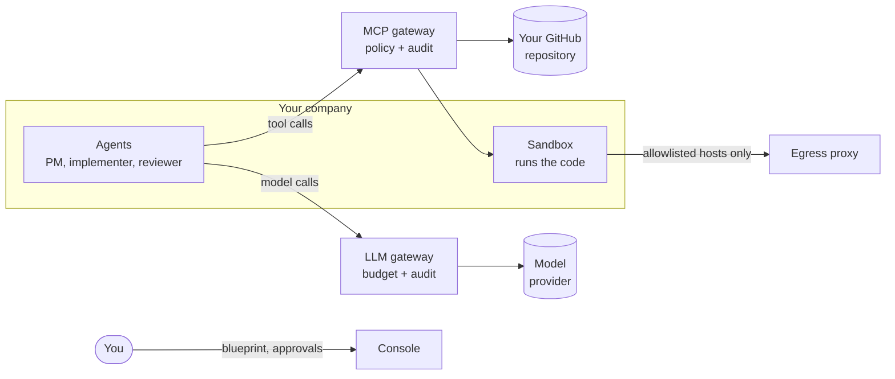

# Poseidon

Poseidon runs a small software company of AI agents on Kubernetes. You
write the company's vision and its limits in one YAML file. The agents
plan, build and review the work on their own, and the platform enforces
your limits in infrastructure, not in prompts.

> [!NOTE]
> **Status: prototype.** Every capability is tested end to end on a local
> [kind](https://kind.sigs.k8s.io/) cluster. Poseidon has never run in
> production. Read the [limitations](docs/explanation/limitations.md)
> before you trust it with anything that matters.

## Why Poseidon

- **You set the rules once.** A *blueprint* declares the vision, the
  repository, the budget, and which merges need your approval. Edit the
  file and apply it again to change any of them.
- **Agents hold no credentials.** Every tool call and every model call
  goes through a gateway that checks compiled policy first. A
  prompt-injected agent can try anything, but it can only do what the
  policy allows.
- **Everything is on the record.** Every decision, tool call, approval
  and dollar spent is an audit row you can read back, run by run.

## How it works



A *heartbeat* wakes up regularly and asks the PM agent what to do next.
The PM turns your vision into tickets. For each ticket, a short-lived crew
writes the code in a sandbox, the platform runs the tests, and an
independent reviewer checks the pull request. You approve the merge, or
let policy approve merges in the paths you choose.

[How it works](docs/explanation/how-it-works.md) explains it in full.

## Quickstart

You need Docker, kind, kubectl, helm, [uv](https://docs.astral.sh/uv/),
Python 3.12, and a GitHub token for a **disposable** repository. The
agents open real pull requests on it.

```bash
uv sync
cp deploy/kind/.env.example deploy/kind/.env   # set GIT_TOKEN
deploy/kind/kind-up.sh                         # creates the cluster and logs you in
```

Copy `examples/hello-saas.yaml` to `company.yaml`, set `stack.repo.url`
to your disposable repository, and apply it:

```bash
uv run poseidon blueprint apply company.yaml --yes
uv run poseidon follow                         # watch the company work
```

The default model is a free, deterministic mock, so this costs nothing.
The [Quickstart](docs/get-started/quickstart.md) walks through every step
and shows the output you should see.

## Documentation

| Section | Read it to… |
|---|---|
| [Get started](docs/get-started/quickstart.md) | Run a company on your machine. |
| [How-to guides](docs/how-to/delegate-merges.md) | Do one specific thing: delegate merges, pause the company, use a real model. |
| [Explanation](docs/explanation/how-it-works.md) | Understand the design and the security model. |
| [Reference](docs/reference/blueprint.md) | Look up a blueprint field, a CLI command, a tool or a policy rule. |
| [Contributing](docs/developing/contributing.md) | Change the code, run the tests, cut a release. |

The pages live under [`docs/`](docs/) and build into a searchable site:

```bash
uv run --group docs mkdocs serve               # http://127.0.0.1:8000
```

The code is thirteen Python packages under `packages/`, each with its own
README. [Packages](docs/developing/packages.md) lists them. What each
release changed is in [`CHANGELOG.md`](CHANGELOG.md).
