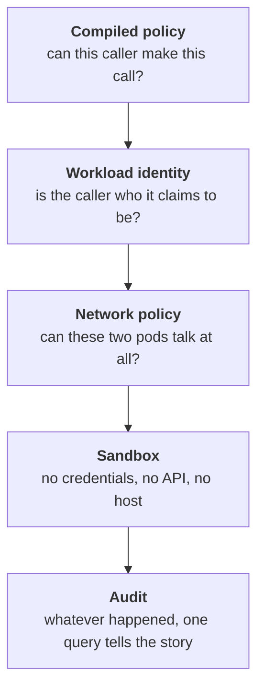

# The core idea

Four ideas do most of the work. Each one turns a question of agent
behaviour into a question of system design.

None of the ideas is new, and that is deliberate. Readers who know Saltzer
and Schroeder's 1975 protection principles will recognise all four: the
credential-free agent is *least privilege* taken to its limit — no ambient
authority at all; the compiled, default-deny blueprint is *fail-safe
defaults* and *economy of mechanism*; the chokepoints are *complete
mediation* — the gateways are a [reference monitor](reading.md)
for agent effects, aspiring to "always invoked" and "small enough to
inspect"; and the verify-then-deliver split of [Anatomy of a run](anatomy.md),
where two independent mechanisms must both fail for unverified code to ship,
is *separation of privilege*. What is new is the principal being confined: a
program whose intent can be rewritten by anything it reads. That makes the
old principles more load-bearing here, not less.

## The agent holds no credentials

Not a GitHub token, not an API key, not a Kubernetes service-account token
for the cluster API. Its pod environment is inspected by a CI gate that
fails the build if a single `*_TOKEN` or `*_KEY` variable with a value
appears in it.

Instead, the agent asks a **gateway** to act on its behalf. The gateway
holds the credential, checks whether this caller may make this call,
refuses before anything happens when the answer is no, and leaves exactly
one audit event either way. An agent that convinces itself to exfiltrate a
token cannot, because there is no token in the room.

A gateway that acts for others is, by construction, a *deputy* — and the
classic failure of deputies is confusion: acting with their own authority
on a request whose provenance they never checked. Poseidon's gateways avoid
that by never taking the caller's word for anything that matters. Identity
is proven cryptographically per call, the caller's run binding is checked
against the registry on every call, and the policy decision is a function
of *who verifiably asked*, not of what the request text claims.

## Authority is compiled, not configured

You write one YAML document — the **company blueprint** — describing roles,
tools, workflows, budgets and policies. A compiler turns it into every
enforcement artifact: Kubernetes custom resources, [Rego](../concepts/opa.md)
policy bundles, NetworkPolicies, sandbox constraints, budget registrations.

The compiler is a pure function. It reads nothing but its arguments and
writes nothing. That makes "the blueprint is the source of truth" a
mechanically checkable claim rather than a slogan — and it means a
governance mistake fails at compile time, with a readable error, instead of
at 3am on the first tool call that hits it.

## Every consequential action passes a chokepoint

Agents face exactly two chokepoint services: the **MCP gateway** (all tool
use — files, shell, git, issues; the sole holder of the git token) and the
**LLM gateway** (all model access; it holds no key itself — the provider
key sits one hop behind it, in an llm-proxy that only the LLM gateway can
reach). That extra hop is deliberate: the proxy is also the translation
layer that lets one OpenAI-shaped wire format reach multiple providers,
and folding it into the gateway would move a large third-party
dependency, the provider key, and external egress into the small
auditable chokepoint. The reference-monitor aspiration is "small enough
to inspect"; the mass stays outside. Both gateways authenticate the
caller's workload identity, both check compiled policy, and both write
exactly one audit event per call. The
ordering guarantee is *deny before side effect*: a denial is recorded and
returned before anything happens, while an allowed call acts first and
then records how the action went.

A person faces one: the **console**, the human-facing chokepoint with the
same shape. It authenticates (a token the API server issued for the
console's own audience — worthless at the gateways, as an agent's is
here), decides (the company's compiled bundle names the humans who may
act, and which act), audits under the person's name, and only then acts.
It is the only thing a person acts through — applying a blueprint,
answering a gate, starting a run by hand, waking or pausing the
heartbeat, deleting the company — which is what makes a merge verdict a
*record*: the workflow releases on the row the console wrote, not on the
signal that woke it.

One more chokepoint, the **egress proxy**, is the only network route out of a
sandbox. Everything else is dropped by NetworkPolicy — silently, as a
backstop beneath the audited layer.

## Containment is layered, and each layer is honest about its job

No single layer is claimed to be sufficient. The sandbox, for instance, does
*not* claim kernel-level isolation — there is no gVisor or Kata runtime
here. What it claims is that privilege inside the sandbox reaches nothing:
no credential to steal, no cluster API to call, no host to mount, one
audited route out. That is a narrower claim, and it is tested by an
adversarial suite that attacks a live sandbox rather than reasoning about it
on paper.
