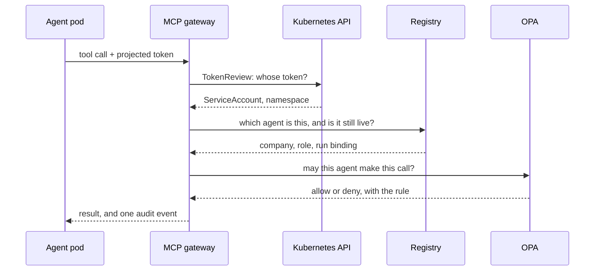

# Workload identity

A shared secret in an environment variable answers "does the caller know
the password?". That's not the same question as "who is the caller?":
anything that reads the variable becomes the caller.

Kubernetes offers something better. It can mount a short-lived token for
a pod's ServiceAccount, scoped to one *audience* (one service that may
accept it). A service that receives the token asks the Kubernetes API,
through the **TokenReview** API, who it belongs to. The answer comes from
the cluster, and the token is useless anywhere outside its audience.

## How the gateways use it

Every agent pod mounts a token for its own ServiceAccount, scoped to the
gateway. The gateway then looks the ServiceAccount up in the registry:

- **Standing agents** map to a row of `agent_instances`. The row records
  the namespace too. The same ServiceAccount name from another namespace
  is an impersonation attempt, refused and recorded.
- **Ephemeral agents** get a ServiceAccount created for their run, and map
  to a live row of `run_participants`. The row *is* the identity: its run,
  crew, role and company.

## Revocation is a database write

The gateway may cache the TokenReview answer, but it reads the registry
row on every call. Deleting the row revokes the agent at once, however
long its token would still be valid. That works the same for an agent
removed from the blueprint as for a crew at the end of its run.

## People

People use the same mechanism with a different audience: the console's. A
person's token fails at both gateways, and an agent's token fails at the
console. [Console API](../reference/console.md#who-a-human-is) explains
how a person signs in.
