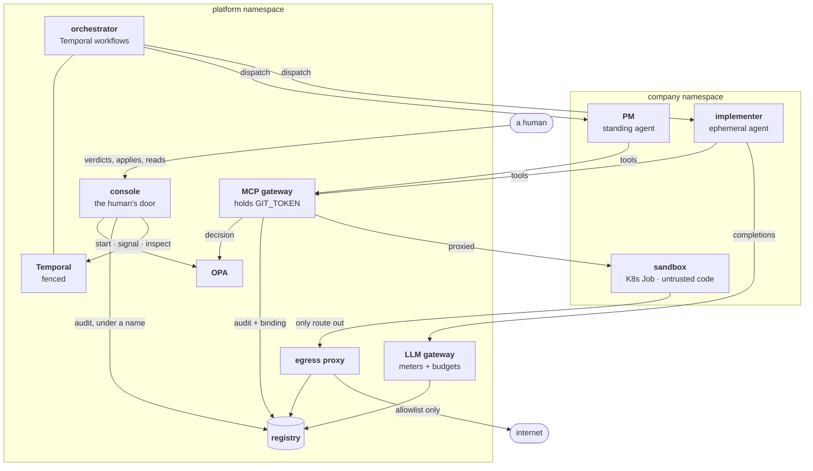

# Architecture

This page shows how a blueprint becomes a running company, and which
component holds which secret. Two paths run through the system. The
**declarative path** turns your blueprint into enforcement. The **runtime
path** does the work under that enforcement.

## The declarative path

Two checks run before anything reaches the cluster:

- **`blueprint`** checks that the document is well-formed: every field
  known, every value of the right type. It needs nothing but the document.
- **`compiler`** checks that the company is coherent: the heartbeat's
  conductor may start the crews the workflows need, every tool scope names
  a real tool, the daily cap can fund at least one run.

Policy is never pushed into OPA (the dotted arrow). The reconciler stores
a policy bundle, and OPA polls for it. After a restart, OPA fetches the
current bundle instead of running on whatever it held in memory. The
company reads `converged` only once OPA serves the bundle the last apply
compiled.

## The runtime path

Every arrow into the registry carries part of a run's story. One query by
`run_id` returns, in order, the gateway's decisions, the egress proxy's
allows and denies, the LLM gateway's spend, the gates' outcomes and your
acts. Six sources write audit events (`gateway`, `llm-gateway`,
`sandbox-infra`, `process-gate`, `process-lifecycle`, `console`), and the
acceptance suite checks that one run's story can be rebuilt from all six.
[Policy and audit](../reference/policy.md) lists the events. Only the
console's rows carry a person's name.

## What each service is responsible for

| Service | Holds | Responsible for |
|---|---|---|
| **reconciler** | — | Reconciling CRs into namespaces, NetworkPolicies, Deployments, RBAC; persisting bundles. Never runs a process, never creates an ephemeral agent. |
| **orchestrator** | egress HMAC key, registry DSN | Temporal workflows, activity sequencing, ephemeral pods and their per-run ServiceAccounts, identity binding, the merge gate's park and its release on the recorded verdict. No `GIT_TOKEN`, no signing key. |
| **console** | registry DSN | Every human act: authenticate the person, decide, audit under their name, act — apply the blueprint (it alone submits the CRs), record and deliver gate verdicts, start or cancel a run, wake, pause or resume the heartbeat, delete the company; and every human read. |
| **MCP gateway** | `GIT_TOKEN` | Every tool call: authenticate, decide, audit, act. |
| **LLM gateway** | — | Every model call: authenticate, attribute to a run, check budget, pin the deployment's model, meter. |
| **llm-proxy** | provider API key | Talking to the actual model provider. Reachable *only* from the LLM gateway. |
| **egress proxy** | egress HMAC key | The one network route out of a sandbox; allowlist + audit. |
| **OPA** | — | Answering decision queries from compiled bundles. |
| **registry** (Postgres) | — | Nine tables, one writer each; the audit and run store. |
| **agent host** | *nothing* | Running the procedure a dispatch names, against the model behind the LLM gateway. Its only credential is its own ServiceAccount's token, for standing and ephemeral agents alike. |
| **sandbox** | *nothing* | Running untrusted workspace code. |

Each service is one workspace package. [Packages](../developing/packages.md)
maps them to their READMEs.

## What kind-up installs

`deploy/kind/kind-up.sh` installs the platform, and knows nothing about any
company. It:

1. creates the kind cluster;
2. installs [Calico](https://docs.tigera.io/calico/), because kind's
   default network plugin ignores NetworkPolicy and the containment tests
   would pass for the wrong reason;
3. builds the nine images and loads them into the cluster;
4. applies the `Company` and `AgentInstance` resource definitions;
5. installs the Poseidon chart and Temporal;
6. checks that every platform pod runs this build;
7. signs you in as `owner`, saving a week-long console token in
   `~/.config/poseidon/token`.

The script is safe to run again after any code or chart change. An applied
company stays applied, and its standing agents restart on the new build.
