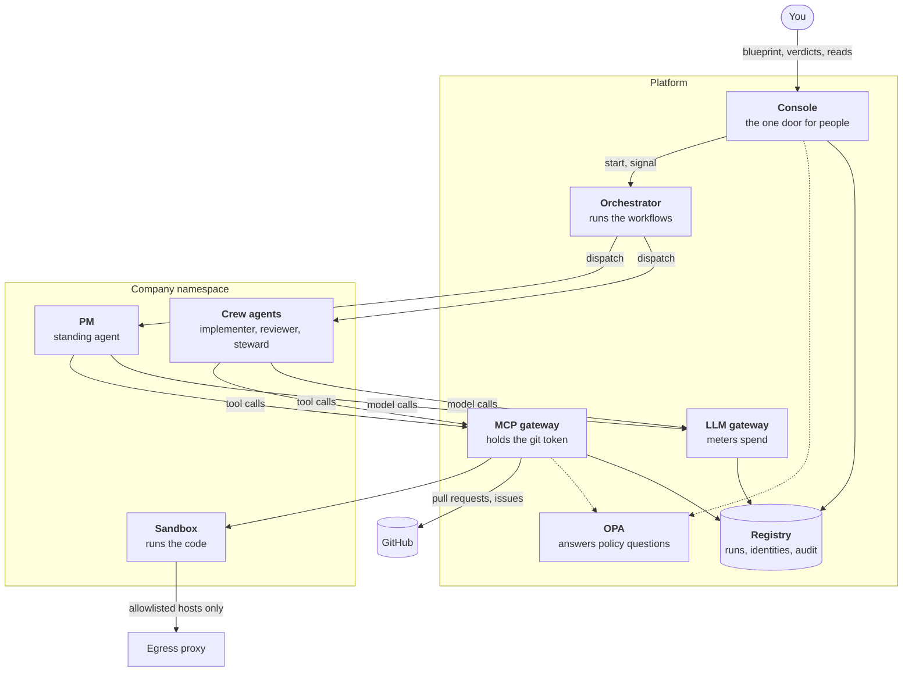
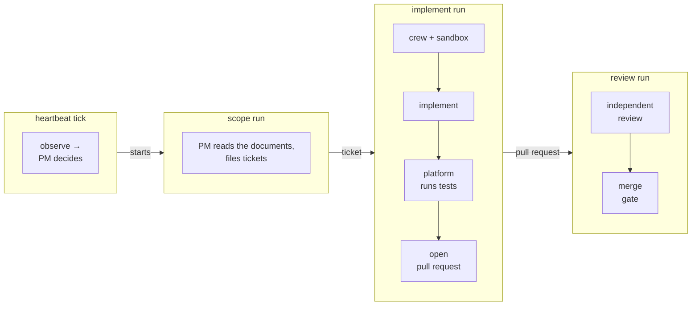

# How it works

A Poseidon company is a loop. It observes its repository, decides what is
worth doing next, does it, records what happened, and repeats for as long
as the company exists. This page follows that loop and names what keeps
each agent contained.

## The pieces

| Piece | What it does |
|---|---|
| **Console** | The one service you act through. It checks who you are, asks policy whether you may, records the act under your name, then does it. The `poseidon` CLI talks to it. |
| **Orchestrator** | Runs the company's workflows on [Temporal](../concepts/temporal.md), creates short-lived agents and sandboxes, and runs the tests that gate delivery. |
| **Agents** | Each agent is one pod running an LLM loop. The PM is *standing*: it lives as long as the company. Crew agents are *ephemeral*: they exist for one run. |
| **MCP gateway** | Every tool an agent uses (read a file, run a command, open a pull request) is a call to this gateway. It checks policy, acts, and records the call. It alone holds the GitHub token. |
| **LLM gateway** | Every model call goes through it. It attributes the cost to a run and refuses calls past the run's budget. |
| **Sandbox** | Where code runs. It holds no credentials, can't reach the cluster API, and reaches the internet only through the egress proxy's allowlist. |
| **OPA** | Answers "may this caller do this?" from policy compiled out of your blueprint. |
| **Registry** | A Postgres database: who each agent is, what each run is doing, and one audit table every component writes to. |

[Architecture](architecture.md) shows how the blueprint becomes this
deployment, and which component holds which secret.

## What the company works from

| Input | Written by | Trusted? |
|---|---|---|
| The **vision** | You, in the blueprint | Yes. It goes into every agent's system prompt, and only you can change it. |
| The **bounds** | The platform, from your blueprint | Yes. The rules that bind the company's work (repository, branches, protected paths, merge rules), in plain text in every agent's system prompt. |
| The **strategy** | The steward agent, once, from the vision | No. It's a file in the repository, read as untrusted text. |
| The **architecture masterplan** | The steward agent, from the vision and the code | No. Agents can propose changes to it, and the steward revises it. |
| Tickets, code, test output, `AGENTS.md` | Agents, people, anyone | No. |

Untrusted text can steer what an agent tries. It can't change what the
platform allows. The [security model](security-model.md) explains why
that line matters.

A new repository has no strategy and no masterplan. The company's first
move is to file two bootstrap tickets, `Bootstrap: strategy` and
`Bootstrap: architecture masterplan`. A *steward* agent writes each
document and delivers it as a pull request like any other change. The
company won't plan work until both documents are on the base branch.

## The loop

The **heartbeat** is a long-running workflow that wakes whenever one of
the company's runs ends, and at least every `reconcile_minutes`. Each tick
it reads the documents, the open tickets and the pull requests waiting for
review. It then asks the PM to pick one action: scope, implement a ticket,
review a pull request, or do nothing. The platform starts the chosen run
only if policy and your caps allow it. [How the heartbeat
decides](heartbeat.md) covers the details.

Each run hands the next one an artifact, never control: scoping produces
tickets, implementing produces a pull request, reviewing produces a merge
decision.

### Scope: from strategy to tickets

The PM reads the strategy and the masterplan and files the next slice of
work as tickets on the repository. Each ticket names the crew that will
build it. The PM can file tickets but can't write code or open pull
requests.

### Implement: from ticket to pull request

1. **A crew is formed.** Policy checks that the PM may start this crew.
   The orchestrator creates one pod per role, each with its own short-lived
   identity, and one sandbox for the run.
2. **The code goes in.** The MCP gateway clones the repository with its
   own token, removes the remote, and hands the sandbox the files. The
   sandbox has nothing to push with.
3. **The implementer works.** It reads, writes and runs commands in the
   sandbox, every call through the gateway. When it's done, it says so.
4. **The platform runs the tests.** The orchestrator runs the test command
   itself. The implementer's claim of success counts for nothing. If the
   tests fail, the implementer gets the failure and tries again, up to
   `max_verify_retries` times.
5. **Only then can it deliver.** A green test run starts a separate
   *deliver* step, the only step whose tools include opening a pull
   request. During implementation, that tool doesn't exist. The deliver
   step's tools can't change the sandbox: the agent names the branch and
   describes the pull request, and the platform commits the sandbox as it
   tested it.
6. **The gateway pushes.** The platform hands the gateway a git bundle of
   that commit. The gateway checks it, computes the changed paths, asks
   policy (protected branches and paths, document rules), then pushes the
   branch and opens the pull request with its own token. If policy refuses
   a path, the implementer gets the refusal, changes the work, and the
   platform tests it again before the next delivery. This counts against
   `max_verify_retries` too.

### Review: an independent check

A fresh sandbox is built from the pull request's head commit. A reviewer
agent, which holds no tool that delivers anything, reads the diff against
the documents, runs the tests, posts its findings, and gives a pass or
fail verdict. Then the [merge gate](merge-gate.md) decides: by default it
waits for your verdict, and you can delegate it to policy for the paths
you choose.

### Teardown

Every run ends the same way, whether it succeeded, failed, was cancelled
or its worker died: the run's identities are revoked, its pods and sandbox
are deleted, and its record is written.

## Four design ideas

**Agents hold no credentials.** No GitHub token, no model API key, no
Kubernetes token for the cluster API. An agent asks a gateway to act for
it, and the gateway checks *who verifiably asked*, never what the request
claims. A CI check fails the build if an agent pod's environment holds a
token or key.

**Authority is compiled from the blueprint.** A compiler turns your
blueprint into every enforcement artifact: [Rego](../concepts/opa.md)
policy, Kubernetes resources, NetworkPolicies, sandbox limits. It's a pure
function, so a mistake fails at compile time with a readable error.
Nothing is allowed unless the blueprint grants it.

**Every action passes a chokepoint.** Agents reach the world only through
the MCP gateway (tools) and the LLM gateway (models). The sandbox reaches
the internet only through the egress proxy. People act only through the
console. Each chokepoint decides before anything happens and records one
audit event per call.

**No single layer is trusted alone.** Policy decides what a caller may
do. [Workload identity](../concepts/workload-identity.md) proves who the
caller is. [NetworkPolicy](../concepts/network-policy.md) decides which
pods can talk at all. The sandbox has nothing to steal. The audit trail
records every decision. The [security model](security-model.md) shows
these layers stopping a real attack.
