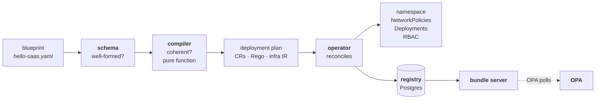
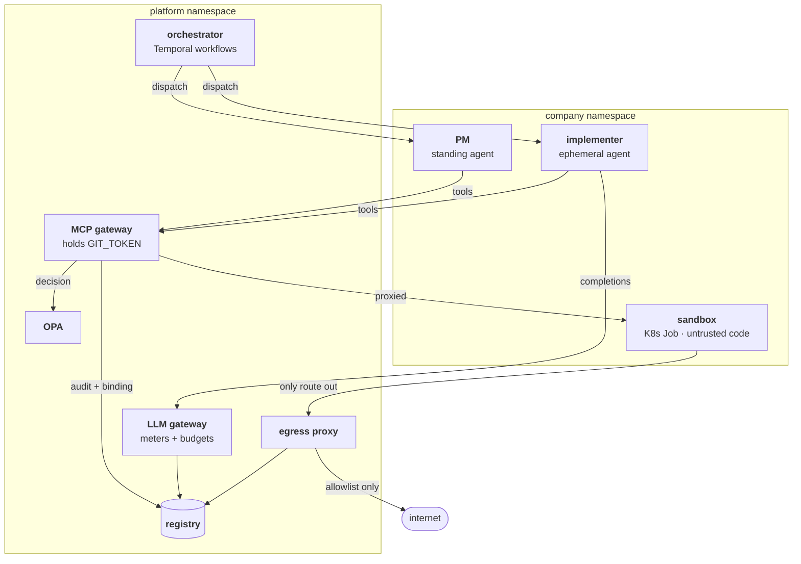

# Architecture

Two paths run through the system. The **declarative path** turns a document
into enforcement; the **runtime path** does work under that enforcement.

## The declarative path

The split between `schema` and `compiler` is worth understanding. `schema`
asks *is this document well-formed?* — a question answerable from the
document alone. `compiler` asks *is this company coherent?* — is the
heartbeat's conductor an active standing spawner, does every scope name a
real tool, can the daily cap fund a run. Both fail before anything reaches
a cluster.

Note the dotted arrow. Policy is **never pushed** into OPA. The operator
persists a bundle; OPA polls for it. That is what makes an OPA restart safe:
it re-fetches the current revision rather than running on whatever it last
held in memory.

## The runtime path

Read the arrows into `registry` as "the whole story of a run ends up here."
One `run_id` query returns the gateway's decisions, the proxy's allows and
denies, the LLM gateway's spend, and the process gates' verdicts, in order.
Five distinct sources write audit events — `gateway`, `llm-gateway`,
`sandbox-infra`, `process-gate`, `process-lifecycle` — and the acceptance
suite asserts that a single run's story is reconstructible across all five
from the `run_id` alone ([Policy and audit](policy.md) lists them).

## What each service is responsible for

| Service | Holds | Responsible for |
|---|---|---|
| **operator** | — | Reconciling CRs into namespaces, NetworkPolicies, Deployments, RBAC; persisting bundles. Never runs a process, never creates an ephemeral agent. |
| **orchestrator** | egress HMAC key, registry DSN | Temporal workflows, activity sequencing, ephemeral pods and their per-run ServiceAccounts, identity binding, the human merge gate. No `GIT_TOKEN`, no signing key. |
| **MCP gateway** | `GIT_TOKEN` | Every tool call: authenticate, decide, audit, act. |
| **LLM gateway** | — | Every model call: authenticate, attribute to a run, check budget, pin the deployment's model, meter. |
| **llm-proxy** | provider API key | Talking to the actual model provider. Reachable *only* from the LLM gateway. |
| **egress proxy** | egress HMAC key | The one network route out of a sandbox; allowlist + audit. |
| **OPA** | — | Answering decision queries from compiled bundles. |
| **registry** (Postgres) | — | Eight tables, one writer each; the audit and run store. |
| **agent** | *nothing* | Running the procedure a dispatch names, against the model behind the LLM gateway. Its credential is its own ServiceAccount's projected token file — for standing agents and ephemeral agents alike. |
| **sandbox** | *nothing* | Running untrusted workspace code. |

Each service is one workspace package; [Packages](../developing/packages.md)
maps them to their READMEs.
