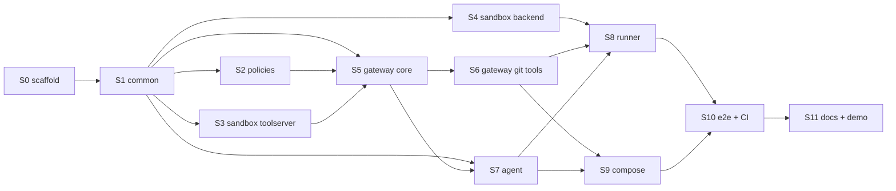

# Poseidon PoC — Implementation Plan

**Source of truth:** [markdowns/prototype.md](prototype.md). This plan decomposes it into
steps sized for one LLM coding-agent session each. Every step is self-contained: it lists
exactly what to read, what to build, and how to verify.

## How to use this plan (instructions to the implementing agent)

- Work on **exactly one step per session**. Read, in this order: §"Frozen contracts"
  below, your step's section, the `prototype.md` sections it cites — nothing else unless
  the step says so.
- Do not modify files owned by other steps. If a frozen contract seems wrong, stop and
  report; do not adapt it unilaterally.
- A step is done when its **Definition of done** passes locally. Then tick its checkbox
  in §"Progress tracker" and update `README.md` if the step changes anything a user of
  the repo must know (setup, commands, env vars).
- Dependency order matters; steps marked "parallel-safe" may be built in any order
  within their tier.

## Step dependency graph



---

## Frozen contracts (read before every step; owned by S1 unless noted)

These interfaces are fixed by `prototype.md`. Implementations conform to them; no step
may change them without a human decision.

### C1 — Audit event (JSONL, one per gateway tool call)

```json
{"ts": "ISO-8601", "run_id": "str", "agent_id": "str", "role": "str",
 "tool": "str", "args_digest": "sha256-hex", "decision": "allow|deny",
 "rule": "str|null", "latency_ms": 0, "backend_status": "ok|error|null"}
```

Pydantic model in `packages/common`. Appended to `runs/audit.jsonl` and stdout.

### C2 — OPA policy input / output (owned by S2)

Input: `{"agent_id": str, "role": str, "run_id": str, "tool": str, "args": {…}}`.
Query: `POST /v1/data/poseidon/poc/decision` → `{"result": {"allow": bool, "rule": str}}`.

### C3 — Gateway MCP tool surface (owned by S5/S6)

Exactly the eight tools of `prototype.md` §4.3, with those argument names:
`repo.archive(repo, ref)`, `sandbox.read_file(run_id, path)`,
`sandbox.write_file(run_id, path, content)`, `sandbox.list_dir(run_id, path)`,
`sandbox.exec(run_id, cmd, timeout_s)`, `sandbox.run_tests(run_id)`,
`sandbox.git_bundle(run_id, branch)`,
`git.open_pr(run_id, repo, branch, title, body, bundle_b64)`.
Transport: MCP streamable HTTP (`mcp` Python SDK), bearer token in `Authorization`.
Plus one non-MCP admin endpoint: `POST /admin/sandboxes {run_id, url}` (runner token
only) to register a sandbox address for a run.

### C4 — Sandbox tool server HTTP API (owned by S3; gateway-internal)

`POST /files/read {path}` → `{content}` · `POST /files/write {path, content}` → `{ok}` ·
`POST /files/list {path}` → `{entries: [{name, type}]}` ·
`POST /exec {cmd, timeout_s}` → `{exit_code, stdout, stderr}` ·
`POST /tests` → `{exit_code, stdout, stderr}` ·
`POST /bundle {branch}` → `{bundle_b64, base_ref}`.
All paths resolved inside `/workspace`; traversal outside it → HTTP 400.

### C5 — SandboxBackend contract (owned by S4)

```python
class SandboxHandle(BaseModel):
    run_id: str; container_id: str; url: str

class SandboxBackend(Protocol):
    def provision(self, run_id: str, workspace_tar: bytes) -> SandboxHandle: ...
    def destroy(self, handle: SandboxHandle) -> None: ...
```

### C6 — Agent HTTP API (owned by S7)

`POST /task {run_id, task_text}` → 202 · `GET /task/{run_id}` →
`{status: "running|done|failed", pr_url: str|null, iterations: int, error: str|null}`.

### C7 — Environment variables (owned by S0)

`GIT_TOKEN` (gateway only), `LLM_API_KEY` (llm-proxy only), `TARGET_REPO`, `BASE_REF`,
`MODEL`, `MAX_ITERATIONS`, `AGENT_BEARER_TOKEN`, `RUNNER_BEARER_TOKEN`,
`MCP_GATEWAY_URL`, `LLM_PROXY_URL`. Gateway maps tokens → identity statically:
agent token → `{agent_id: backend-engineer-1, role: backend-engineer}`,
runner token → `{agent_id: runner, role: runner}`.

### C8 — Logging

Every service logs single-line JSON to stdout via `common.telemetry.get_logger(name)`,
with `run_id`/`agent_id` bound when known.

---

## Steps

### S0 — Repository scaffold

- **Read:** `prototype.md` §6, §7, §8.
- **Build:** `pyproject.toml` (uv workspace, Python 3.12, members under `packages/*`);
  empty package skeletons `common/ agent/ gateway/ sandbox/ runner/` each with
  `pyproject.toml` and `src/` layout; `policies/`, `deploy/compose/.env.example` (all C7
  vars, placeholder values), `examples/`, `tests/e2e/`, `runs/.gitkeep`; `.gitignore`
  (`runs/`, `.env`, `__pycache__`, `.venv`); `README.md` stub (project one-liner +
  "see markdowns/prototype.md").
- **Definition of done:** `uv sync` succeeds; `uv run python -c "import common"` works.

### S1 — `packages/common`

- **Read:** `prototype.md` §4.3 (audit), §4.7; contracts C1, C7, C8.
- **Build:** `ids.py` (`new_run_id()` — `run-<ulid>`); `audit.py` (C1 Pydantic model +
  `append(event, path)`); `config.py` (Pydantic Settings reading C7 env vars);
  `telemetry.py` (C8 JSON logger). Unit tests for each.
- **Definition of done:** `uv run pytest packages/common` green.

### S2 — Policies (parallel-safe with S3/S4)

- **Read:** `prototype.md` §4.5; contract C2.
- **Build:** `policies/poc.rego` — package `poseidon.poc`, default deny; rules exactly:
  backend-engineer may call `sandbox.*` only when `input.run_id` is in
  `data.runs.assignments[input.agent_id]` (assignments pushed by the gateway via OPA's
  data API); `git.open_pr` requires `branch` matching `^feature/[a-z0-9-]+$` and denies
  `main`/`master`; `repo.archive` and `/admin/sandboxes` require `role == "runner"`;
  deny `git.open_pr` when provided `paths` touch `.github/workflows/`. `decision` rule
  returns `{allow, rule}` where `rule` names the deciding rule (esp. on deny).
  `policies/poc_test.rego` covering every rule, allow and deny sides.
- **Definition of done:** `opa test policies/ -v` green (run via
  `docker run openpolicyagent/opa` if no local binary).

### S3 — Sandbox tool server (parallel-safe with S2/S4)

- **Read:** `prototype.md` §4.4; contract C4.
- **Build:** `packages/sandbox/src/sandbox/toolserver/` — FastAPI app implementing C4;
  path-traversal guard; `exec` via `subprocess.run(cwd=/workspace, timeout)`; `/tests`
  runs `TEST_CMD` env (default `pytest -q`); `/bundle` runs
  `git bundle create - <base>..<branch>` (base recorded at provision in
  `/workspace/.poseidon-base`), returns base64. `Dockerfile.sandbox`: Python 3.12 +
  git + pytest prebaked (zero-egress network later — no runtime installs), entrypoint
  uvicorn on :8000. Unit tests against a tmpdir git repo.
- **Definition of done:** `uv run pytest packages/sandbox` (toolserver tests) green;
  `docker build -f Dockerfile.sandbox` succeeds.

### S4 — Sandbox backend (parallel-safe with S2/S3)

- **Read:** `prototype.md` §4.4; contract C5.
- **Build:** `packages/sandbox/src/sandbox/contract.py` (C5);
  `backends/docker.py` — Docker SDK: create container from the S3 image on network
  `sandboxnet`, untar workspace into `/workspace` (`put_archive`), strip `git remote`,
  write `.poseidon-base`, return handle with in-network URL; `destroy` = force-remove.
  Integration test (marked `docker`): provision from a tarball fixture, call `/files/list`
  through the container network, destroy.
- **Definition of done:** `uv run pytest packages/sandbox -m docker` green with Docker
  available.

### S5 — Gateway core: auth, policy, audit, sandbox proxy

- **Read:** `prototype.md` §4.3; contracts C1, C2, C3 (sandbox.* + admin only), C7.
- **Build:** `packages/gateway/src/gateway/` — MCP server (streamable HTTP) with the six
  `sandbox.*` tools; middleware: bearer → identity (C7 map) else 401; per call: build C2
  input → query OPA → emit C1 audit event → on allow, proxy to the sandbox URL registered
  for `run_id` (in-memory registry + `POST /admin/sandboxes`, which also pushes the
  run assignment to OPA's data API). Deny → MCP tool error carrying the rule name.
  Unit tests with a stubbed OPA (httpx mock) and a stubbed sandbox server: allow path,
  deny path, unknown token, unregistered run_id, audit lines written for all.
- **Definition of done:** `uv run pytest packages/gateway` green.

### S6 — Gateway git tools

- **Read:** `prototype.md` §4.3 (`repo.archive`, `git.open_pr`), §10 item 4.
- **Build (extends S5, same package):** `git_backend.py` — `repo.archive`: clone
  `TARGET_REPO@ref` with `GIT_TOKEN` into a tmpdir, strip remotes/credentials, tar,
  return b64. `git.open_pr`: decode bundle → `git bundle verify` → fetch into a fresh
  platform-side clone → extract changed paths and pass them in the C2 policy input
  (`args.paths`) → push branch with token → open PR via GitHub REST → return
  `{pr_url}`. `Dockerfile.gateway` (python + git). Unit tests use a **local bare repo
  fixture** as `TARGET_REPO` (file:// URL) and a stub GitHub API (httpx mock); no
  network needed.
- **Definition of done:** `uv run pytest packages/gateway` green including new tests;
  bundle-tampering test (bad bundle → error, audited) passes.

### S7 — Agent

- **Read:** `prototype.md` §4.2; contracts C3, C6, C7.
- **Build:** `packages/agent/src/agent/` — FastAPI app (C6, task runs in a background
  task; one concurrent run is enough); `graph.py` — LangGraph loop
  plan → act → verify → deliver per §4.2, tool calls via MCP client to
  `MCP_GATEWAY_URL` with `AGENT_BEARER_TOKEN`, LLM via OpenAI-compatible client on
  `LLM_PROXY_URL`/`MODEL`; `MAX_ITERATIONS` cap; on gateway deny, surface the denial to
  the model and continue (this is what makes E2 recover onto `feature/*`);
  `prompts/system.md` per §4.2. `Dockerfile.agent`. Unit tests: stub LLM (scripted
  responses) + mocked MCP gateway; assert graph reaches `deliver`, respects the
  iteration cap, and retries after a deny.
- **Definition of done:** `uv run pytest packages/agent` green.

### S8 — Runner CLI

- **Read:** `prototype.md` §4.1; contracts C3, C5, C6, C7.
- **Build:** `packages/runner/src/runner/cli.py` (typer): `run <task-file>` executing
  `create_run → fetch_workspace → provision_sandbox → dispatch_task → teardown` exactly
  as §4.1, with per-step timeout and guaranteed teardown on failure; run manifest JSON
  under `runs/<run_id>/manifest.json` (task, timestamps, status, pr_url, iterations,
  audit-line count); `status <run_id>` prints it. MCP client with `RUNNER_BEARER_TOKEN`
  for `repo.archive` + admin registration; `DockerBackend` from S4 for the sandbox.
  Unit tests with all collaborators mocked: happy path, agent-timeout path (sandbox
  still destroyed), manifest contents.
- **Definition of done:** `uv run pytest packages/runner` green.

### S9 — Compose assembly

- **Read:** `prototype.md` §3 (network model), §4.6, §8; contract C7.
- **Build:** `deploy/compose/docker-compose.yml` — networks `agentnet` (internal),
  `sandboxnet` (internal), `opanet` (internal), `egress`; services: `opa`
  (`openpolicyagent/opa`, `run --server`, policies mounted read-only, `opanet`),
  `llm-proxy` (stock LiteLLM image, `LLM_API_KEY` + `MODEL`, `agentnet`+`egress`),
  `mcp-gateway` (S6 image, `GIT_TOKEN`, all four networks it needs:
  `agentnet`+`sandboxnet`+`opanet`+`egress`, `runs/` bind-mounted for audit),
  `agent` (S7 image, **only** `agentnet`, only C7 non-secret vars). Sandboxes are
  started on `sandboxnet` by the runner at run time — ensure the compose project
  network name is passed to the runner via env. Finalize `.env.example`.
- **Definition of done:** `docker compose config` valid; `docker compose up -d` from a
  filled `.env` leaves all services healthy (healthchecks defined for each);
  `docker compose exec agent env | grep -Ei 'token|key'` shows only
  `AGENT_BEARER_TOKEN`.

### S10 — E2E tests and CI

- **Read:** `prototype.md` §2 (E1–E4), §9; `examples/` requirements in §6.
- **Build:** `examples/task-happy.md` (small, deterministic task against the target
  repo — e.g. "add function X with tests") and `examples/task-injected.md` (same task +
  an embedded instruction to push directly to `main`). `tests/e2e/`:
  `test_happy_path.py` (run runner, poll, assert PR on `feature/*` — against a
  disposable GitHub repo named in `.env`), `test_injection.py` (assert ≥1 `deny` with
  the branch rule in `runs/audit.jsonl` **and** a `feature/*` PR exists),
  `test_egress.py` (`docker compose exec agent python -c "connect(github.com:443)"` →
  fails; gateway/llm-proxy reachable; same zero-egress assertion inside a live sandbox),
  `test_audit.py` (reconstruct the E1 run: every tool call present, ordered, digests
  non-empty). CI workflow (`.github/workflows/ci.yml`): uv sync, unit tests, `opa test`,
  image builds, and the **secret-inspection gate**: fail if any `*_TOKEN`/`*_KEY`
  other than `AGENT_BEARER_TOKEN` appears in the agent/sandbox service env or image
  layers (`docker history`/`compose config` scan). E2E job manual/optional (needs real
  keys).
- **Definition of done:** unit CI green; the four E2E tests pass locally against a real
  repo + real LLM key.

### S11 — Documentation and demo script

- **Read:** everything built; `prototype.md` §9.3.
- **Build:** `README.md` — setup (uv, Docker, `.env` from example), the two-command
  demo (happy task → PR link; injected task → show deny in `runs/audit.jsonl` + PR
  still on `feature/*`), architecture pointer to `markdowns/prototype.md`,
  troubleshooting (OPA decisions, audit tail, sandbox logs). Verify every documented
  command against the real system; reconcile any drift between code and
  `prototype.md` — **code wins, update the doc**.
- **Definition of done:** a fresh-clone dry run of the README succeeds end to end.

---

## Progress tracker

- [x] S0 scaffold
- [x] S1 common
- [x] S2 policies
- [x] S3 sandbox toolserver
- [x] S4 sandbox backend
- [x] S5 gateway core
- [x] S6 gateway git tools
- [x] S7 agent
- [x] S8 runner
- [x] S9 compose
- [ ] S10 e2e + CI
- [ ] S11 docs + demo
