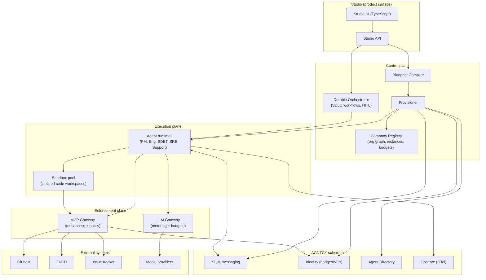
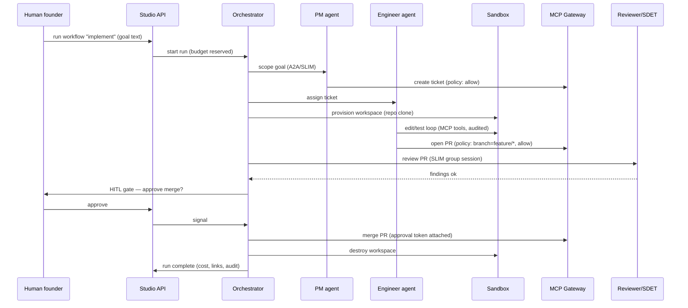

# Technical Specification — Software Company Builder on AGNTCY

**Purpose:** a platform that takes a declarative description of a software company (roles, stack, workflows, policies, budgets) and materializes it as a governed multi-agent system running on AGNTCY infrastructure. The agents do the work of a software team: scoping, coding, reviewing, releasing, supporting.

**Positioning:** this is a control plane and execution substrate built *on top of* AGNTCY primitives (SLIM messaging, Identity, Directory, OASF, Observe). It introduces no new agent protocol. Agent-to-agent communication is A2A over SLIM; tool access is MCP.

---

## 1. System overview



**Three invariants:**

1. **Agents hold no credentials.** Every external side effect (git push, CI trigger, ticket update, model call) passes through a gateway that authenticates the agent via its AGNTCY Identity badge and evaluates policy per call.
2. **Company-level processes are durable.** A feature can take days and wait on humans; orchestration state survives restarts and lives outside any agent's memory.
3. **The company is declarative.** The blueprint is the source of truth; the provisioner reconciles reality toward it (hire, fire, reorg = blueprint diffs).

---

## 2. Components

### 2.1 Blueprint & Schema (`schema`)

The **Company Blueprint** is a YAML document validated by JSON Schema. It declares:

- **Company:** name, mission, product description, stage.
- **Stack:** languages, frameworks, repo layout (monorepo/multi-repo), infra targets.
- **Departments and roles:** which role templates to instantiate, how many, with what seniority parameters (model tier, autonomy level).
- **Tools:** which MCP-fronted systems each role may use (git, CI, issues, docs), with method-level scopes.
- **Workflows:** which SDLC processes are enabled and their gate configuration (e.g. "release requires human approval").
- **Policies:** path ownership, branch protection expectations, data handling rules, escalation rules.
- **Budgets:** token/$ caps per role, per workflow run, per month.

Role templates are also published as **OASF records** (skills, domains, custom modules for SDLC metadata) so they are valid AGNTCY citizens and can later be shared or discovered via the Directory.

Example (abridged):

```yaml
company:
  name: hello-saas
  product: "Uptime monitoring for indie developers"
stack:
  languages: [python, typescript]
  repos: [{ name: app, layout: monorepo }]
departments:
  engineering:
    roles:
      - template: backend-engineer
        count: 2
        model_tier: frontier
      - template: sdet
        count: 1
workflows:
  release:
    gates: { production_deploy: human_approval }
budgets:
  per_run: { implement: { usd: 15 } }
```

### 2.2 Blueprint Compiler (`compiler`)

Pure function: **blueprint → deployment plan**. It:

- Validates the blueprint against the schema and cross-checks consistency (every workflow node maps to a hired role; every tool scope references a registered MCP backend; budgets cover enabled workflows).
- Resolves role templates from the Role Catalog into concrete agent specs (system prompts, tool scopes, model routing, SLIM topics to join).
- Emits an ordered, idempotent **deployment plan**: identity subjects to create, badges to issue, SLIM topics/groups to create, agent runtimes to launch, gateway policies to install, budgets to register.

The plan is diffable: compiling a modified blueprint against the current registry state produces a change set (this is how hire/fire/reorg works).

### 2.3 Provisioner (`provisioner`)

Executes deployment plans through adapters. One adapter per substrate concern:

- **IdentityAdapter:** registers the company as an org, creates a subject and issues a badge per agent instance and per MCP backend. Revocation on teardown/fire.
- **SlimAdapter:** creates the company namespace, department topics, and group sessions (e.g. `review`, `incident`) on the SLIM instance.
- **RuntimeAdapter:** launches agent runtime containers with their spec (prompt, role, gateway endpoints, badge). No other environment is injected — this is how "no credentials on agents" is verified by construction.
- **GatewayAdapter:** installs per-role policy bundles into the MCP Gateway and budget entries into the LLM Gateway.
- **DirectoryAdapter (optional):** publishes role templates as OASF records to an Agent Directory for sharing/discovery. Ephemeral agent *instances* are never published to the federated directory; they live in the Company Registry.

Provisioning is reconciling: re-running against a live company converges it to the plan, and teardown reverses it (revoke badges, stop runtimes, drop namespace).

### 2.4 Company Registry (`registry`)

Postgres-backed source of runtime truth:

- **Org graph:** departments, reporting lines, path ownership (which role owns `src/billing/**`).
- **Instance table:** hired agents, their badges, runtime status, SLIM identities.
- **Budget ledger:** allocations, consumption (fed by LLM Gateway), and remaining headroom per scope.
- **Run history:** workflow runs, gate decisions, artifacts (PR links, deploy IDs).

The registry is the join point between the declarative blueprint and live state; the compiler diffs against it.

### 2.5 Durable Orchestrator (`orchestrator`)

Built on a durable workflow engine (**Temporal** recommended; any engine with timers, signals, and replay works). Owns company-level SDLC processes:

| Workflow | What it does |
|---|---|
| **intake** | Product goal → PM agent scopes it → tickets created via MCP → budget reserved |
| **implement** | Ticket → assigns engineer agent → sandbox provisioned → agent iterates (code, test) → PR opened via gateway |
| **review** | PR → reviewer + SDET agents in a SLIM group session → findings posted → gate: merge policy |
| **release** | Merged changes → SRE agent prepares release → **parks on human approval signal** → deploy via gateway → verify |
| **incident** | Alert webhook → war-room SLIM group (SRE lead + owners of implicated paths) → mitigation → postmortem draft |

Key properties:

- **Human-in-the-loop is an orchestrator primitive**, not an agent feature: a workflow pauses on a signal; the Studio surfaces pending approvals; approve/reject resumes the workflow. Timeouts escalate per policy.
- Agents are invoked as activities (A2A calls over SLIM); the orchestrator handles retries, timeouts, and compensation (e.g. close abandoned PRs, release sandbox).
- LangGraph (or similar) is used *inside* an agent for its local reasoning loop; it never carries cross-agent process state.

### 2.6 MCP Gateway (`gateway-mcp`)

The single route to every external system. It is an MCP server multiplexer:

- Terminates agent MCP connections, authenticates the caller via its Identity badge.
- Evaluates policy (**OPA/Rego or Cedar**) per call with full context: agent role, target tool + method, arguments (e.g. branch name, file paths), active workflow run, budget state.
- Proxies allowed calls to backend MCP servers (git, CI, issue tracker, docs, feature flags) using **platform-held** credentials.
- Emits an audit event for every decision (allow/deny, who, what, when, in which run).

Example enforced rules: engineers can push to `feature/*` but never `main`; only the release workflow's SRE agent can trigger a production deploy, and only when the run carries an approval token; support agents can read tickets but not repos.

### 2.7 LLM Gateway (`gateway-llm`)

All model traffic passes through it:

- Routes by role's model tier (frontier / mid / cheap) and provider availability.
- Meters tokens and cost per agent, per workflow run, per company; writes consumption to the budget ledger.
- **Hard-stops** requests when a cap is exhausted and signals the orchestrator, which pauses the run and raises an escalation instead of silently degrading.
- Normalizes provider APIs so agent runtimes are provider-agnostic.

An existing proxy (e.g. LiteLLM) can be embedded; the custom part is budget integration and run attribution.

### 2.8 Agent Runtimes (`agents`)

One containerized runtime per hired agent instance. Each runtime:

- Serves **A2A over SLIM** (via the AGNTCY App SDK) so supervisors, peers, and the orchestrator can address it; joins its department topics and any group sessions it's invited to.
- Runs the role's reasoning loop (LangGraph-style graph): receive task → plan → act through its tool surface → report.
- Has exactly three egress paths: SLIM (messaging), MCP Gateway (tools), LLM Gateway (models). Nothing else resolves.
- Emits OTel traces via the Observe SDK, tagged with company/run/agent IDs.

Role templates shipped at start: **PM, Backend Engineer, Frontend Engineer, SDET, SRE, Support**. A template = system prompt + tool scope + reasoning graph + model tier + evaluation hooks.

### 2.9 Sandbox Pool (`sandbox`)

The execution substrate for coding work — the part that makes this a *software* company builder:

- Per-task, disposable, containerized workspace: repo clone at the right ref, toolchain image matching the stack, network egress restricted to package registries via an allowlist proxy.
- The engineer agent drives it through a constrained tool surface (read/write files, run commands, run tests) exposed as MCP tools — meaning sandbox actions are also policy-checked and audited.
- **No secrets inside.** Git credentials never enter the sandbox: the workspace works on a local clone, and the final diff is pushed by the MCP Gateway on the agent's behalf after policy checks.
- Lifecycle owned by the orchestrator: provision on task start, snapshot on interruption, destroy on completion; caps on CPU/memory/duration.

### 2.10 KPI & Audit (`kpi`)

Two ingestion paths, joined in one store:

- **Agent telemetry** (OTel from Observe SDK): tokens, latencies, loop iterations, tool-call patterns — answers "how are the agents behaving".
- **Delivery events** (webhooks from git/CI): PR opened/merged, build results, deploys, incidents — answers "is the company shipping" (DORA-style: cycle time, change failure rate, MTTR).

Plus the **audit log** assembled from gateway decisions and orchestrator gate outcomes — the compliance trail of who did what under which approval.

### 2.11 Studio (`studio-api`, `studio-ui`)

- **API:** blueprint CRUD, compile/preview (show the deployment plan and projected cost before applying), provision/teardown, workflow start, approval inbox (pending HITL gates), KPI queries.
- **UI:** org chart with live agent status, run timeline per workflow, approval queue, budget dashboards, audit search. Thin client over the API.

---

## 3. Technology choices

| Concern | Choice | Rationale |
|---|---|---|
| Control plane, orchestrator, agents | **Python** | AGNTCY App SDK, LangGraph, and Temporal SDK are all first-class in Python; one language until a component proves hot |
| Durable workflows | **Temporal** (self-hosted) | Signals (HITL), timers, replayable history for run forensics |
| Policy | **OPA/Rego** (or Cedar) | Policy-as-code, testable, decoupled from gateway code |
| LLM proxy base | LiteLLM (embedded) + custom budget layer | Don't rebuild provider adapters |
| State | **Postgres** | Registry, ledger, run metadata |
| Sandboxes | Docker/containerd (POC) → gVisor/Firecracker (hardened) | Progressive isolation strength |
| Messaging | **SLIM** via App SDK; NATS as fallback transport | Group sessions for review/incident; abstraction keeps the fallback cheap |
| UI | TypeScript + React | Standard |
| Blueprints | YAML + JSON Schema; OASF modules for role records | Validation + AGNTCY citizenship |

---

## 4. Repository structure

```text
sw-company-builder/
  packages/
    schema/          # blueprint JSON Schema, OASF role modules, examples
    compiler/        # blueprint → deployment plan, diffing
    provisioner/     # identity / slim / runtime / gateway / directory adapters
    registry/        # org graph, instances, budget ledger (Postgres models + API)
    orchestrator/    # Temporal workflows + activities for the 5 SDLC processes
    gateway-mcp/     # MCP multiplexer + OPA policy bundles + audit emitter
    gateway-llm/     # routing, metering, budget enforcement
    agents/          # role runtimes: pm/, backend/, frontend/, sdet/, sre/, support/
    sandbox/         # workspace images, exec MCP tool server, pool manager
    kpi/             # OTel ingestion, git/CI webhook ingestion, DORA queries
    studio-api/
  studio-ui/
  policies/          # Rego policy source (versioned, tested)
  deploy/            # docker-compose (dev), helm (later): SLIM, Temporal, Postgres, gateways
  examples/
    hello-saas/      # reference blueprint + walkthrough
```

---

## 5. Where the difficulties will lie

Ranked by expected pain:

1. **Sandbox security.** Coding agents execute arbitrary generated code. Container escape, egress abuse (exfiltration via package registry lookalikes), and resource abuse are the top threats. Mitigations — syscall filtering, egress allowlist proxy, no secrets in the workspace, push-via-gateway — must hold *by construction*, and hardening (gVisor/Firecracker) has real operational cost.
2. **Gateway completeness.** The policy model is void if any agent path bypasses it. This requires discipline (runtime containers get only gateway endpoints + badge, verified in CI by inspecting images/env) and continuous red-teaming with prompt-injection payloads that try to reach `main`, prod, or raw credentials.
3. **Agent work quality.** Provisioning an org is deterministic; getting the PM to scope well and the engineer to produce merge-worthy PRs is not. Expect the majority of ongoing effort in role prompts, reasoning graphs, and eval suites. Design assumption: **human on merge-to-main and prod deploy until evals justify relaxing** — the platform makes gates configurable per company so autonomy can be earned per role.
4. **Long-running orchestration edge cases.** Sandbox dies mid-task, reviewer deadlocks with author, human never approves, budget exhausts at 90% of a task. Every workflow needs explicit compensation paths (close PR, release sandbox, escalate, snapshot-and-park). Temporal gives the machinery; the design work is enumerating the failure matrix.
5. **SLIM operational maturity.** Group session management (membership churn during incidents, MLS key rotation) at scale is comparatively young territory. Keep transport behind the App SDK abstraction and maintain the NATS fallback until confidence is earned.
6. **Blueprint/reality reconciliation.** Live companies drift (a run is mid-flight when a reorg lands). The compiler-diff model handles structure, but draining rules are needed: what happens to an in-flight `implement` run when its engineer role is eliminated (finish, reassign, abort?). Policy decision per workflow.
7. **Cost attribution accuracy.** Budgets are only as good as run attribution in the LLM Gateway; fan-out (one task, many sub-calls, group sessions) makes "which run pays for this token" genuinely fiddly. Propagate run IDs in every A2A envelope from day one.

---

## 6. Delivery scopes

### POC — "one agent ships one PR under policy"

**Goal:** prove the core loop and enforcement invariant end-to-end. Single company, hardcoded org (no compiler).

- One backend-engineer agent + one supervisor stub, A2A over SLIM (single topic).
- MCP Gateway with static Rego policy fronting one git backend; deny push-to-main demonstrably works.
- Minimal sandbox: Docker workspace, file/exec MCP tools, diff pushed by gateway.
- One hand-rolled `implement` flow (a script, not yet Temporal): ticket text in → PR opened out.
- LLM calls direct to provider (no LLM gateway yet); basic OTel traces.

**Exit criteria:** given a small task on a real repo, the agent produces a PR through the gateway; an injected "push directly to main" instruction is blocked and audited.

### MVP — "a blueprint becomes a working 4-role company"

**Goal:** the declarative pipeline exists; a design partner can run it on a real repo.

- Blueprint schema + compiler + provisioner (identity badges, SLIM namespace, runtime launch, policy install; teardown works).
- Company Registry with org graph and instance table.
- Temporal orchestrator running **intake → implement → review** with compensation paths; HITL gate on merge.
- LLM Gateway with per-run budget hard-stop.
- Roles: PM, Backend Engineer, SDET, plus supervisor. Sandbox with egress allowlist.
- Studio API only (CLI-driven); approval via API endpoint. Audit log queryable.

**Exit criteria:** from `hello-saas.yaml`: provision, run intake→implement→review on a real ticket, human approves merge via API, budget exhaustion pauses a run, teardown revokes everything (verified by a failed post-teardown agent call).

### V1 — "operable product"

**Goal:** multiple companies, a UI, and the full SDLC.

- **release** and **incident** workflows (human-gated prod deploy; alert-webhook-triggered war-room group session).
- Studio UI: org chart, run timelines, approval inbox, budget dashboards, audit search.
- Full role set (add Frontend, SRE, Support); role templates published as OASF records.
- KPI store with DORA metrics from git/CI webhooks joined with agent telemetry.
- Multi-tenancy: per-company SLIM namespace + Identity org on shared infra; per-company data isolation in Postgres.
- Blueprint diff → live reconciliation (hire/fire/reorg with run-draining rules).
- Sandbox hardening pass one (gVisor or equivalent), CI verification that agent images contain no credentials.

**Exit criteria:** two isolated companies on shared infra; a feature goes idea→production with exactly two human approvals; an injected incident produces a war-room and a postmortem draft; KPI dashboard shows real cycle times.

### V2 — "ecosystem and earned autonomy"

Directional, to be re-scoped on V1 learnings:

- **Earned autonomy:** eval suites per role feed gate configuration — e.g. auto-merge for low-risk paths once a role's rolling PR-acceptance score clears a threshold; autonomy is granted and revoked per role, per path, backed by data.
- **Marketplace:** import third-party role templates and external specialist agents (e.g. security reviewer) discovered via the federated Agent Directory, contracted through Identity badges and scoped gateway policies.
- **Cross-company collaboration:** one built company consumes another's agents as vendors (design agency company serving product companies) over federated SLIM/Identity trust.
- Dedicated SLIM instances per enterprise tenant; Firecracker sandboxes; SOC2-oriented audit export.
- Blueprint authoring copilot: describe the product in prose → draft blueprint.

---

## 7. End-to-end example (MVP flow)



---

## 8. Summary

Build order mirrors the risk order: prove **agent → sandbox → gateway → PR** first (POC), then make it **declarative and durable** (MVP), then make it **operable and multi-tenant** (V1), then open it to an **ecosystem with earned autonomy** (V2). AGNTCY supplies identity, discovery, messaging, and observability; this platform supplies everything a company adds on top of individuals: structure, process, permission, and accountability.