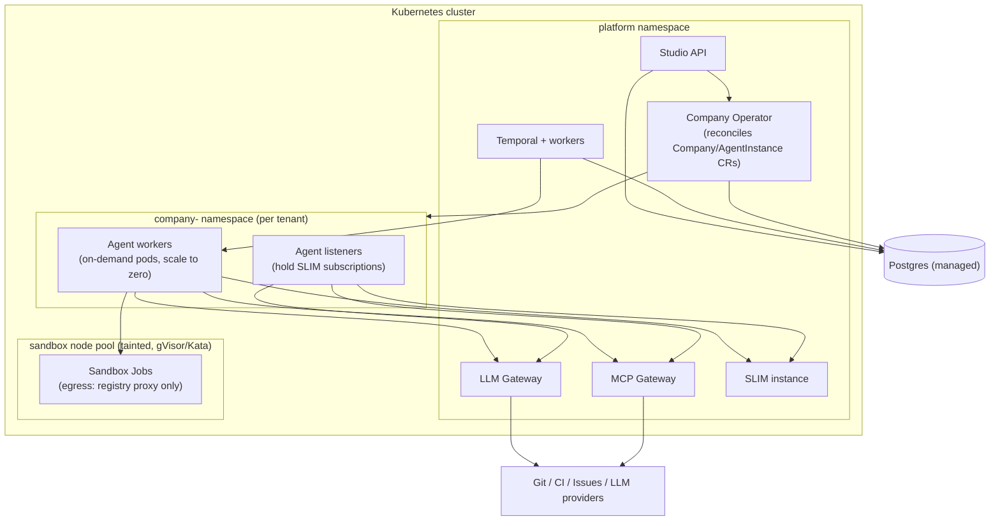

# Prompt after Specification 1

"Read you last response/plan and challenge it on 2 aspects : where will things run (k8s,…) and where can we reuse AGNTCY components and where not. After that propose an adapted plan if needed."

# Challenge 1 — Where does this actually run?

The spec said "docker-compose (dev), helm (later)" and had a `RuntimeAdapter` that "launches agent runtime containers." That hides four real problems.

**1. The Provisioner reinvents Kubernetes, badly.** A component that takes a declarative desired state (blueprint), diffs it against live state, launches/kills containers, and "reconciles" — that *is* the Kubernetes operator pattern. Building a custom reconcile loop that shells out to Docker means rebuilding scheduling, health checks, restarts, and placement with none of the guarantees. The provisioner should compile blueprints into **Custom Resources** (`Company`, `AgentInstance`) and let a **Company Operator** own reconciliation. You get convergence, self-healing, and drift detection from the platform instead of writing it.

**2. The "nothing else resolves" invariant had no enforcement mechanism.** The spec asserted agents can only reach SLIM + the two gateways, but never said *what enforces that*. On Kubernetes the answer is concrete: **NetworkPolicy** (or Cilium policies) per agent namespace — egress allowed to gateway services and SLIM only, deny-all otherwise. Without an enforcement primitive, that invariant was a wish.

**3. One long-lived container per hired agent is wasteful and was never questioned.** A 6-role company = 6+ pods burning memory while idle, times N companies. Long-lived processes are only *required* where an agent must hold a SLIM subscription (group sessions, department topics). Orchestrator-driven work (implement, review activities) can run as on-demand pods/jobs. The model should be hybrid: a thin always-on **listener** per agent that holds SLIM subscriptions, and heavy reasoning work dispatched as Temporal-activity-backed jobs that scale to zero.

**4. Sandboxes-on-Kubernetes was glossed over.** "Docker workspace" inside a K8s cluster means Docker-in-Docker or privileged pods — exactly wrong for untrusted generated code. The workable pattern: **Kubernetes Jobs on a dedicated, tainted node pool with a hardened RuntimeClass (gVisor or Kata)**, egress restricted by NetworkPolicy to the package-registry proxy. Alternatively outsource to a sandbox service (E2B, Modal, Fly Machines) and skip operating that node pool at all — a legitimate MVP shortcut the spec never considered.

Everything else (Temporal, Postgres, gateways, SLIM, Studio) is ordinary stateful/stateless K8s workloads via Helm, with managed Postgres/Temporal Cloud as sensible outsourcing options.

---

# Challenge 2 — Where is AGNTCY reuse real, and where was it inflated?

Component by component, honestly:

| AGNTCY component | Spec claimed | Reality | Verdict |
|---|---|---|---|
| **SLIM** | Transport for *all* agent communication | The orchestrator mediates most flows as point-to-point activity calls — plain A2A-over-HTTP works there. SLIM uniquely earns its keep for **group sessions** (review war-rooms, incident bridges) and later cross-org federation. Forcing every orchestrator→agent call through it adds a young infra dependency to the critical path | **Reuse, narrowed** — group comms + federation; HTTP default elsewhere |
| **App SDK** | A2A server/client factory | Genuine fit, and it abstracts SLIM/NATS/HTTP transports — which is exactly the seam the narrowed SLIM usage needs | **Reuse as-is** |
| **Identity** | Badge verified on every gateway call | VC/badge verification per MCP call is heavyweight and the ecosystem is young. Internal east-west auth is a solved problem: workload identity (K8s service accounts / SPIFFE-style JWTs) is simpler, faster, and boring. AGNTCY Identity's real value is **inter-organizational trust** — proving your agents to outsiders and verifying external marketplace agents | **Reuse, repositioned** — org boundary (V1/V2), not the internal hot path |
| **Directory** | Publish role templates | No functional role before a marketplace exists; it's interop citizenship, not a dependency | **Defer to V2** |
| **OASF** | Role templates as OASF records | Same: the blueprint JSON Schema is the operative source of truth; OASF records are an export format for sharing | **Defer to V2** |
| **Observe SDK** | OTel traces | It's OTel; adoption cost near zero | **Reuse as-is** |
| **Workflow Server** | (ignored) | Correctly not needed — Temporal + custom runtimes covers it; now stated explicitly | **No reuse, deliberate** |

**The uncomfortable conclusion:** the majority of the system — gateways, budgets, sandboxes, orchestration, registry, compiler, studio — is AGNTCY-independent. AGNTCY contributes group messaging, cross-org identity, telemetry conventions, and (later) marketplace rails. That's still worth building on — it's precisely the layer you shouldn't invent — but two design consequences follow:

1. **Keep AGNTCY behind the App SDK / adapter seam everywhere**, so an immature component (SLIM ops, Identity tooling) can be swapped without touching the core.
2. **Nothing young sits on the POC/MVP critical path.** The POC must not fail because of SLIM group session quirks; groups enter at MVP where they're actually needed (review).

---

# Adapted plan (delta from the spec)

## Revised runtime architecture



Key changes:

- **Provisioner becomes a Kubernetes operator** (`operator/` replaces `provisioner/`). Compiler output = Custom Resources; the operator reconciles them. Written in Python with `kopf` to keep the one-language rule (revisit Go/kubebuilder only if it proves limiting).
- **Namespace-per-company** with deny-all NetworkPolicy; egress only to gateways and SLIM. The security invariant is now enforced by the platform, not by convention.
- **Hybrid agent runtime:** thin listener Deployment per agent for SLIM subscriptions; reasoning work runs as on-demand worker pods driven by Temporal activities.
- **Sandboxes = K8s Jobs on a tainted node pool with hardened RuntimeClass**; a pluggable backend interface so MVP can use a hosted sandbox service instead of operating gVisor from day one.
- Postgres and Temporal preferably managed; SLIM and gateways self-hosted in-cluster.

## Revised AGNTCY integration

- **Transport:** App SDK factory everywhere; **HTTP for orchestrator→agent activities, SLIM for group sessions** (review, incident) and anything cross-org. NATS remains the group-comms fallback.
- **Identity:** internal auth = K8s workload identity + short-lived JWTs enforced at gateways from POC. AGNTCY Identity badges issued at **V1** for company/agent provenance, and required at **V2** for external/marketplace agents.
- **Directory + OASF:** removed from MVP; V2 marketplace deliverables (publish role templates as OASF records, discover/contract external agents via Directory).
- **Observe:** unchanged, from POC.

## Revised repo structure (delta)

```text
  packages/
    operator/        # kopf operator: Company + AgentInstance CRDs, reconcile   (was: provisioner/)
    compiler/        # blueprint → CRs + gateway policy bundles                 (output changed)
    sandbox/         # backend interface: k8s-jobs | hosted-service             (pluggable)
    ...              # schema/ registry/ orchestrator/ gateways/ agents/ kpi/ unchanged
  deploy/
    helm/            # platform chart: operator, temporal, gateways, slim
    networkpolicies/ # per-company egress templates (part of the security model, versioned)
  crds/              # Company, AgentInstance definitions
```

## Revised phase scopes

| Phase | Runtime | AGNTCY surface |
|---|---|---|
| **POC** | docker-compose only; sandbox = local container | App SDK A2A over **HTTP**; Observe traces. No SLIM, no Identity — the PR-under-policy loop must not depend on young infra |
| **MVP** | K8s + operator + namespace-per-company + NetworkPolicies; sandbox backend = hosted service *or* basic K8s Jobs | **SLIM group session for review** (its first load-bearing use); internal JWT auth at gateways |
| **V1** | Hardened sandbox node pool (gVisor/Kata); HA gateways; multi-company on shared cluster | AGNTCY **Identity badges** for company/agent provenance; incident war-rooms on SLIM groups |
| **V2** | Dedicated clusters/SLIM per enterprise tenant; Firecracker option | **Directory + OASF**: publish role packs, discover and contract external agents across org boundaries |

Exit criteria gain one item each: **POC** — agent pod/container demonstrably cannot reach any endpoint except the gateways (egress test). **MVP** — operator converges a live company after a blueprint edit without manual steps. **V1** — badge revocation locks an agent out of both gateways. **V2** — an external Directory-discovered agent completes a review under scoped policy.

---

**Net effect:** the plan gets *more* conventional where it was hand-rolled (Kubernetes owns reconciliation and isolation) and *more honest* where it was optimistic (AGNTCY = group messaging + cross-org trust + telemetry + future marketplace, behind a seam — not a blanket substrate). The core product thesis and component set are unchanged.