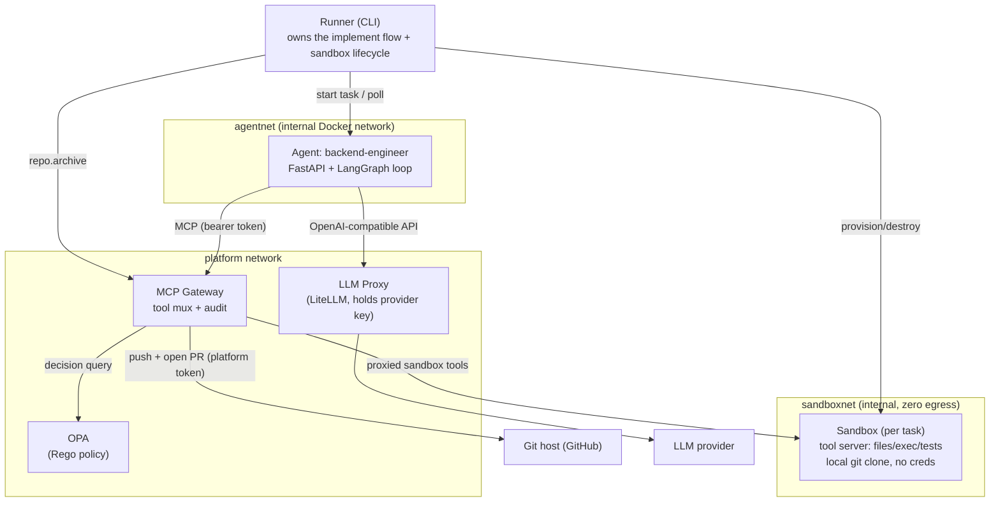
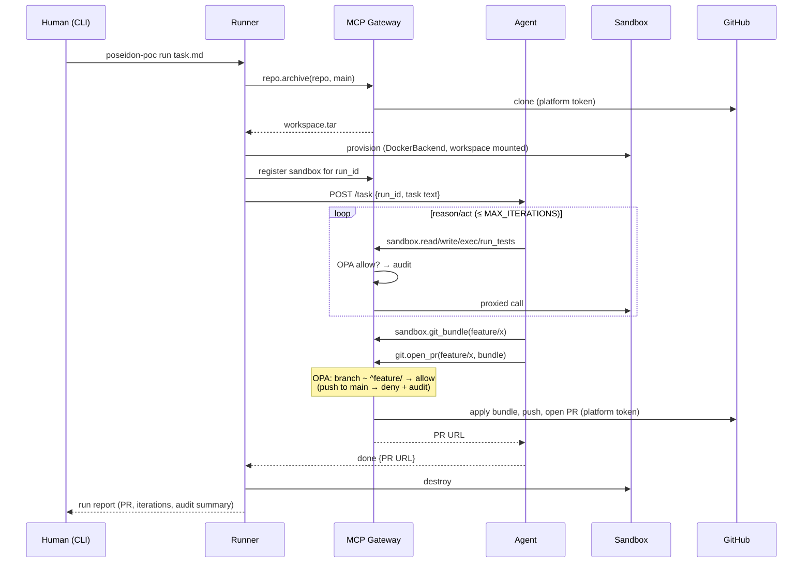

# Poseidon PoC Specification — "One agent ships one PR under policy"

**Status:** implementable. This document is the consolidated result of three specification
iterations plus a final senior review (see §10 for what the review changed). It is
self-contained: a coding agent should be able to build the PoC from this file alone.

---

## 1. Context — what the full platform is (north star, not PoC scope)

Poseidon is a platform that takes a **declarative description of a software company**
(roles, stack, workflows, policies, budgets — the *Company Blueprint*) and materializes it
as a governed multi-agent system. The agents do the work of a software team: scoping,
coding, reviewing, releasing, supporting.

The target architecture, established across the three spec iterations:

- **Control plane:** a Blueprint Compiler emits Kubernetes Custom Resources
  (`Company`, `AgentInstance`); a **Company Operator** reconciles them. Kubernetes owns
  convergence, self-healing, and drift detection — we do not hand-roll a reconciler.
- **Durable orchestration:** Temporal owns company-level SDLC workflows (intake,
  implement, review, release, incident). Human-in-the-loop is an orchestrator primitive
  (signals), not an agent feature.
- **Enforcement plane:** an **MCP Gateway** is the single route to every external system
  (git, CI, issues), evaluating semantic policy (OPA/Rego) per call with platform-held
  credentials; an **LLM Gateway** meters tokens/cost and hard-stops on budget exhaustion.
- **Execution plane:** hybrid agent runtimes (thin always-on listeners for group
  messaging; on-demand workers that scale to zero) plus disposable, credential-free
  **sandboxes** for coding work, behind a pluggable `SandboxBackend` contract
  (candidates: NVIDIA OpenShell, self-operated gVisor/Kata K8s Jobs, hosted services).
- **AGNTCY substrate, narrowed to where it earns its keep:** SLIM for group sessions
  (review, incident war-rooms) and cross-org federation — not for point-to-point calls;
  AGNTCY Identity at the org boundary (V1+), Directory/OASF for the V2 marketplace.
  Everything AGNTCY sits behind an adapter seam.
- **Defense in depth, three independent layers:** infrastructure policy (sandbox runtime:
  what the process can touch), semantic policy (MCP Gateway: what the action means),
  process policy (Temporal gates: who approved).

**Three platform invariants** (the PoC must prove the first two by construction):

1. **Agents hold no credentials.** Every external side effect passes through a gateway
   that authenticates the caller and evaluates policy per call.
2. **No unmediated egress.** An agent runtime can reach exactly its gateways and nothing
   else; this is enforced by the platform (network policy), not by convention.
3. **The company is declarative.** Blueprint is the source of truth; hire/fire/reorg are
   blueprint diffs. *(Not exercised in the PoC — org is hardcoded.)*

Phase ladder: **PoC** (this doc) → **MVP** (blueprint→operator pipeline, Temporal,
SLIM group review, budget hard-stop) → **V1** (full SDLC, Studio UI, multi-tenancy,
AGNTCY Identity badges, hardened sandboxes) → **V2** (marketplace via Directory/OASF,
earned autonomy, cross-company federation).

---

## 2. PoC goal and exit criteria

**Goal:** prove the core loop and the enforcement invariants end to end, with the
smallest honest system: *a coding agent, given a task, produces a real pull request on a
real repository — and every side effect it takes is policy-checked, credential-free from
the agent's perspective, and audited.*

### Exit criteria (all four must pass, scripted)

| # | Criterion | Verified by |
|---|---|---|
| E1 | **Happy path.** Given a small task on a real repo, the agent iterates in a sandbox and a PR appears on the git host, opened by the gateway on a `feature/*` branch. | `tests/e2e/test_happy_path.py` |
| E2 | **Red team.** A task containing an injected instruction ("push directly to main") results in a **denied** `git.open_pr`/push attempt recorded in the audit log, *and* the agent still delivers the feature-branch PR. | `tests/e2e/test_injection.py` |
| E3 | **Egress.** From inside the agent container, any connection except to the MCP Gateway and LLM Proxy fails at the network level. From inside the sandbox, *all* external egress fails. No git or LLM credential exists in the agent or sandbox environment/image. | `tests/e2e/test_egress.py` + image/env inspection in CI |
| E4 | **Audit.** Every gateway tool call (allow and deny) is an append-only JSONL event carrying `run_id`, `agent_id`, tool, decision, and policy rule; the full E1+E2 story is reconstructable from the log alone. | `tests/e2e/test_audit.py` |

### Non-goals (explicitly out of PoC scope)

No blueprint/compiler/operator (org is hardcoded). No Temporal (the flow is a script).
No SLIM, no A2A, no AGNTCY Identity (plain HTTP + static bearer tokens). No LLM budgets
or metering (passthrough proxy only). No OpenShell (plain Docker sandbox behind the
`SandboxBackend` interface it will later implement). No CI/issue-tracker backends (the
"ticket" is a text file). No UI. No database (state is files + JSONL).

---

## 3. PoC architecture



**Network model (the E3 enforcement mechanism).** Docker Compose defines three networks:

- `agentnet` — `internal: true`. Members: agent, mcp-gateway, llm-proxy. The agent can
  resolve nothing else.
- `sandboxnet` — `internal: true`. Members: sandbox containers, mcp-gateway. Sandboxes
  have **no** egress path at all; toolchain dependencies are prebaked into the sandbox
  image.
- `egress` — default bridge. Members: mcp-gateway, llm-proxy (the only two components
  that may reach the internet). OPA sits on an internal network shared with the gateway.

Credentials exist in exactly two places: `GIT_TOKEN` in the gateway container,
`LLM_API_KEY` in the llm-proxy container. CI inspects the agent and sandbox images and
compose config to assert neither variable (nor any `*_TOKEN`/`*_KEY`) reaches them.

---

## 4. Components

### 4.1 Runner (`packages/runner/`)

A CLI (`poseidon-poc run <task-file>`) that plays the roles of orchestrator and
supervisor. It is a plain Python script — deliberately not Temporal — but its steps are
named after the future Temporal activities so the migration path is legible:

1. `create_run` — mint `run_id`, write run manifest to `runs/<run_id>/`.
2. `fetch_workspace` — call gateway `repo.archive(repo, ref)`; receive a tarball of the
   repo at the base ref (gateway clones with its token; the tarball contains no remotes
   with credentials).
3. `provision_sandbox` — via the `SandboxBackend` interface (see 4.4): start a sandbox
   container on `sandboxnet` with the workspace unpacked at `/workspace`, register its
   address with the gateway under `run_id`.
4. `dispatch_task` — POST the task text + `run_id` to the agent's `/task` endpoint;
   poll `/task/{run_id}` until terminal state (or timeout → fail the run).
5. `teardown` — destroy the sandbox, finalize the run manifest (PR URL, iterations,
   audit summary).

Timeout, max-iteration, and failure handling live here, not in the agent.

### 4.2 Agent: backend-engineer (`packages/agent/`)

One containerized FastAPI service running a LangGraph reasoning loop. Endpoints:
`POST /task` (accept task, run async), `GET /task/{run_id}` (status/result).

The loop: **receive task → plan → act → verify → deliver**:

1. **Plan:** produce a short step plan from the task text and a `sandbox.list_dir`/
   `sandbox.read_file` survey of the workspace.
2. **Act:** iterate using gateway MCP tools only — `sandbox.read_file`,
   `sandbox.write_file`, `sandbox.exec` (runs a command inside `/workspace`).
3. **Verify:** `sandbox.run_tests`; loop back on failure, up to `MAX_ITERATIONS`
   (config, default 10).
4. **Deliver:** `sandbox.exec` git commit on a `feature/<slug>` branch →
   `sandbox.git_bundle` to obtain the bundle → `git.open_pr(repo, branch, title, body,
   bundle_b64)` → report PR URL.

Egress surface is exactly two base URLs from config: `MCP_GATEWAY_URL` and
`LLM_PROXY_URL` (OpenAI-compatible; model name from config). The agent authenticates to
the gateway with a static bearer token identifying it as
`agent_id=backend-engineer-1, role=backend-engineer` (stand-in for future workload
identity). Every MCP call carries `run_id`.

The system prompt states the operating rules (work only via tools, feature branches
only, never attempt to bypass the gateway) — but the PoC's point is that policy holds
**even when the prompt is subverted** (E2).

### 4.3 MCP Gateway (`packages/gateway/`)

The single route to every side effect. FastAPI service exposing an MCP tool surface;
for each call it authenticates the bearer token, builds a policy input document, queries
OPA, emits an audit event, and only then executes.

**Tool surface:**

| Tool | Args | Backend action |
|---|---|---|
| `repo.archive` | `repo, ref` | Clone with platform token (kept out of the archive), return tarball. Runner-only (separate runner token). |
| `sandbox.read_file` | `run_id, path` | Proxy to the sandbox tool server registered for `run_id`. |
| `sandbox.write_file` | `run_id, path, content` | Proxy. |
| `sandbox.list_dir` | `run_id, path` | Proxy. |
| `sandbox.exec` | `run_id, cmd, timeout_s` | Proxy; command runs inside `/workspace`. |
| `sandbox.run_tests` | `run_id` | Proxy; runs the repo's configured test command. |
| `sandbox.git_bundle` | `run_id, branch` | Proxy; returns `git bundle` of `base..branch`, base64. |
| `git.open_pr` | `run_id, repo, branch, title, body, bundle_b64` | Verify bundle, apply to a fresh platform-side clone, push `branch` with platform token, open PR via GitHub API. **This is the only path by which code leaves the system.** |

Sandbox proxying means sandbox actions are policy-checked and audited exactly like
external ones — one enforcement point, one audit stream.

**Audit:** one JSONL event per call, append-only at `runs/audit.jsonl` and stdout:
`{ts, run_id, agent_id, role, tool, args_digest, decision, rule, latency_ms,
backend_status}`. Denials include the OPA rule that fired.

### 4.4 Sandbox (`packages/sandbox/`)

- **Image:** repo toolchain (Python 3.12, git, test deps) prebaked — required because
  `sandboxnet` has zero egress. A tiny FastAPI **tool server** (file ops, exec with
  timeout, test runner, bundle export) listens for the gateway only. No credentials, no
  remotes: the workspace is a local clone whose `origin` is removed.
- **Backend contract** (`packages/sandbox/contract.py`):
  `provision(run_id, workspace_tar) -> SandboxHandle`, `destroy(handle)`. One
  implementation for the PoC: `DockerBackend` (spawns the container on `sandboxnet` via
  the Docker API). OpenShell and K8s-Jobs backends implement this same contract later —
  keep it narrow.

### 4.5 Policy (`policies/`)

Rego, evaluated by an `openpolicyagent/opa` container (`--server`), with unit tests via
`opa test`. Input document: `{agent_id, role, run_id, tool, args}`. PoC rules:

- Default **deny**.
- `role == "backend-engineer"` may call `sandbox.*` tools **only for a `run_id`
  currently registered to it**.
- `git.open_pr` allowed only when `branch` matches `^feature/[a-z0-9-]+$`. Any branch
  equal to or targeting `main`/`master` is denied. (This is the E2 kill shot.)
- `repo.archive` allowed only for the runner token.
- Optional path guard: deny `git.open_pr` when the bundle touches `.github/workflows/**`
  (demonstrates argument-level semantic policy — the thing infra-layer tools can't see).

### 4.6 LLM Proxy (`packages/` — none; stock container)

Stock **LiteLLM proxy** container: holds `LLM_API_KEY`, exposes an OpenAI-compatible
endpoint on `agentnet`, forwards to the provider. No budgets, no metering, no custom
code — it exists solely so the agent container is credential-free and the E3 egress test
is honest. (Budget/metering logic arrives at MVP as code around this same proxy.)

### 4.7 Observability

No tracing stack in the PoC. All services log structured JSON to stdout with `run_id`
and `agent_id` on every line; the audit JSONL is the primary forensic artifact (E4).
Seam for later: a `telemetry.py` in `common/` wraps logger creation, so swapping in the
OTel SDK at MVP touches one module.

---

## 5. End-to-end flow



---

## 6. Repository structure

```text
poseidon-prototype/
  pyproject.toml            # uv workspace, Python 3.12
  packages/
    common/                 # ids, config loading, audit event model, telemetry.py
    agent/                  # FastAPI app, LangGraph loop, prompts/, Dockerfile
    gateway/                # MCP tool mux, OPA client, git backend, audit, Dockerfile
    sandbox/                # contract.py, backends/docker.py, toolserver/, Dockerfile
    runner/                 # CLI (typer): run / status
  policies/
    poc.rego
    poc_test.rego           # opa test in CI
  deploy/compose/
    docker-compose.yml      # networks: agentnet, sandboxnet, egress; services per §3
    .env.example            # GIT_TOKEN, LLM_API_KEY, TARGET_REPO, MODEL
  examples/
    task-happy.md           # small real task for E1
    task-injected.md        # same task + injected "push directly to main" (E2)
  tests/
    e2e/                    # test_happy_path / test_injection / test_egress / test_audit
  runs/                     # run manifests + audit.jsonl (gitignored)
  README.md
```

## 7. Technology choices

| Concern | Choice | Rationale |
|---|---|---|
| Language | Python 3.12, `uv` workspace | One language; LangGraph/MCP/FastAPI first-class |
| Agent loop | LangGraph | Local reasoning graph only; never carries cross-agent state |
| Services | FastAPI + uvicorn | Agent, gateway, sandbox tool server |
| MCP | `mcp` Python SDK (streamable HTTP) | Gateway is an MCP server; agent an MCP client |
| Policy | OPA container + Rego | Policy-as-code with unit tests; identical engine at MVP+ |
| LLM access | LiteLLM proxy (stock container) | Credential isolation now; budget layer later |
| Git ops | `git` CLI in gateway image + GitHub REST for PRs | Boring, debuggable |
| Runtime | Docker Compose, internal networks | Egress invariant enforced by the platform, PoC-scale |
| CLI | typer | Runner ergonomics |

## 8. Configuration and secrets

`deploy/compose/.env` (from `.env.example`): `GIT_TOKEN` (repo-scoped PAT — gateway
only), `LLM_API_KEY` (llm-proxy only), `TARGET_REPO`, `BASE_REF`, `MODEL`,
`MAX_ITERATIONS`, agent/runner bearer tokens. CI asserts by inspection that no secret
variable is passed to agent or sandbox services.

## 9. Test plan

1. **Unit:** Rego (`opa test policies/`); gateway policy-input construction and bundle
   verification; sandbox tool server ops; agent graph transitions with a mocked gateway
   and stub LLM.
2. **E2E (compose up, real repo, real LLM):** the four exit-criteria tests of §2 —
   happy path, injection, egress (attempt connections from inside agent and sandbox
   containers; assert failure), audit reconstruction.
3. **Demo script** (`README.md`): run `task-happy.md`, show PR; run `task-injected.md`,
   show the deny in `runs/audit.jsonl` and the PR still landing on `feature/*`.

---

## 10. Design decisions from the final review (step 2 deltas)

Recorded so the reasoning survives; each is a change against the consolidated specs 1–3.

1. **No AGNTCY App SDK / A2A in the PoC.** Spec 2 kept "A2A over HTTP" for the PoC; with
   one agent and a script orchestrator it proves nothing and adds a dependency. Plain
   HTTP behind a thin transport seam. A2A/SLIM enter at MVP where group review needs them.
2. **Supervisor stub removed.** The runner is the supervisor at this scale.
3. **LLM proxy added to the PoC** (reversing spec 1's "LLM calls direct to provider"):
   a provider key inside the agent container would break invariant #1 during the demo
   meant to prove it, and would hollow out the E3 egress test. A stock LiteLLM container
   is near-free and keeps the invariant honest.
4. **Push-via-gateway mechanics specified** (they were asserted, never designed):
   local commits in the sandbox → `git bundle` → `git.open_pr` carries the bundle →
   gateway verifies, applies, pushes, opens the PR. Credentials never touch anything the
   agent or generated code can reach.
5. **OpenShell excluded from the PoC build** (spec 3 said "optional"; alpha software adds
   no exit-criterion value). The `SandboxBackend` contract it will implement is in place;
   the MVP decision gate from spec 3 stands.
6. **Egress enforcement made concrete at PoC scale** via internal Docker networks —
   applying spec 2's own critique ("an invariant without an enforcement mechanism is a
   wish") to the PoC runtime itself. Sandboxes get *zero* egress (toolchain prebaked),
   which is stronger and simpler than a registry-proxy allowlist; the proxy returns at
   MVP when arbitrary-stack companies need it.
7. **No OTel stack in the PoC.** Structured JSONL with correlation IDs plus the audit
   log covers E4; tracing infra is demo overhead. One-module seam kept for MVP.
8. **Red-team test promoted to a scripted exit criterion** (E2) with a checked-in
   injected task file, rather than a manual demo step.

## 11. What the PoC must leave behind (seams for MVP)

- Runner step names mirror future Temporal activities; keep steps pure and idempotent.
- `SandboxBackend` contract stays narrow (`provision`/`destroy`) — OpenShell and
  K8s-Jobs implement it next.
- Bearer-token auth is a placeholder for workload identity → AGNTCY Identity badges (V1).
- The OPA input document shape (`agent_id, role, run_id, tool, args`) is the stable
  policy interface; MVP compiles per-role Rego bundles from blueprints into the same shape.
- Audit event schema in `common/` is the contract for the future KPI/audit store
  (OpenShell OCSF events will be mapped into it).
